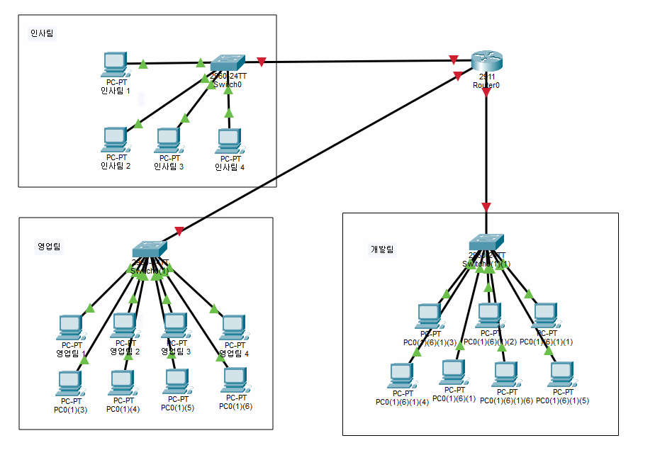
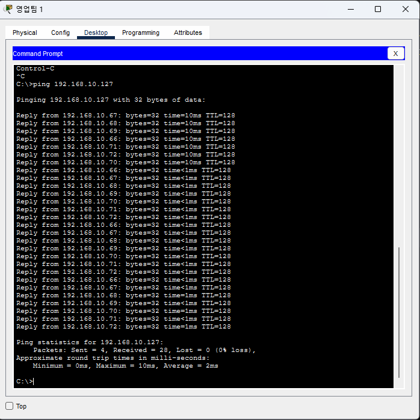

# 1일차 작업 계획서

- 날짜:2026-11-01

## 1. 목표

- 각 부서 내부에서 네트워크 통신이 가능하도록 IP 할당 및 서브넷팅

## 2. 작업 대상

| 대상 | 무엇을 |
|------|--------|
|전체|PC의 IP 할당 작업|

## 3. 작업 내용

1. 각 부서별 PC IP 할당을 통해 PC간 데이터 통신이 가능하게 만든다.

## 4. 확인 방법

| 확인할 것 | 방법 | 기대하는 결과 |
|-----------|------|---------------|
|PC의 IP 할당 상태|다른 PC의 IP를 활용해 Ping 패킷을 보내고 받는다.|모든 Ping 패킷 신호가 정상적으로 수신 및 발신이 가능하다|
|각 부서 내부에서 통신|네트워크의 브로드캐스트 IP로 ping 브로드캐스트|같은 네트워크 대역에 있는 모든 PC가 리플라이 패킷 송신|
|다른 부서와 나뉨|브로드캐스트로 다른 부서에서 패킷을 수신할 수 있는지 확인|수신 불가능|

## 5. 되돌리는 방법

- PC의 IP 할당 정보를 초기화한다.

## 6. 결과

- 한 일: 서브넷팅을 통해 각 부서별 IP 할당 표 제작

|Subnet ID | Subnet Address | Host Address Range | Broadcast Address |
|----|----|----|---|
|1|192.168.10.0|192.168.10.1 - 192.168.10.62|192.168.10.63|
2|192.168.10.64|192.168.10.65 - 192.168.10.126|192.168.10.127
3|192.168.10.128|192.168.10.129 - 192.168.10.190|192.168.10.191
4|192.168.10.192|192.168.10.193 - 192.168.10.254|192.168.10.255

- 확인 결과:

- 막힌 곳과 어떻게 풀었나: 없음
- 다음 회차에 이어서 할 일: 라우터 설정(개발 팀에서만 라우터에 접속 가능하게), 스위칭 VLAN